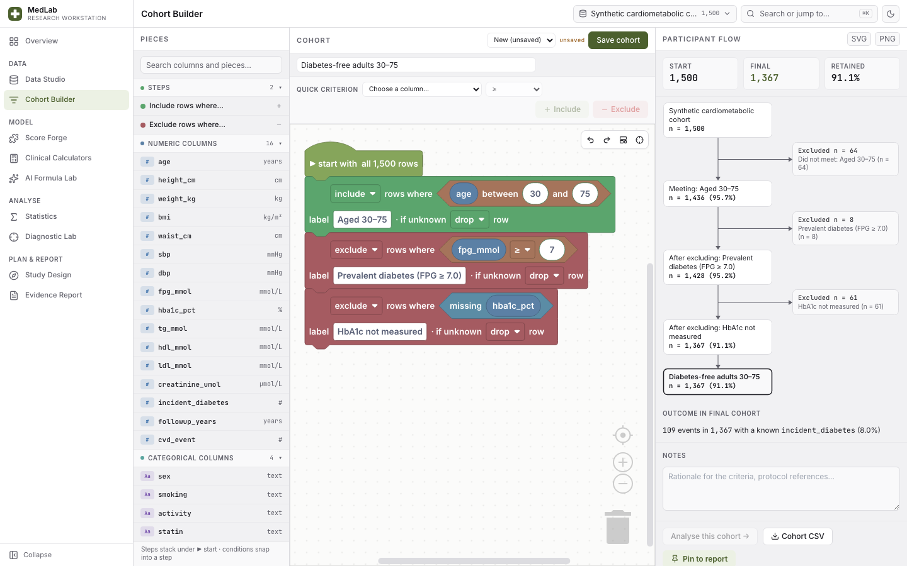
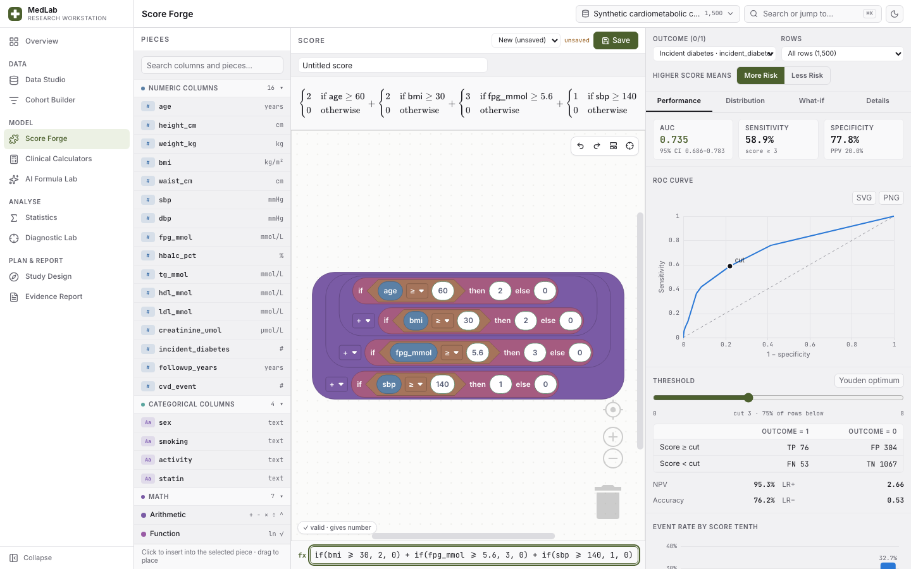
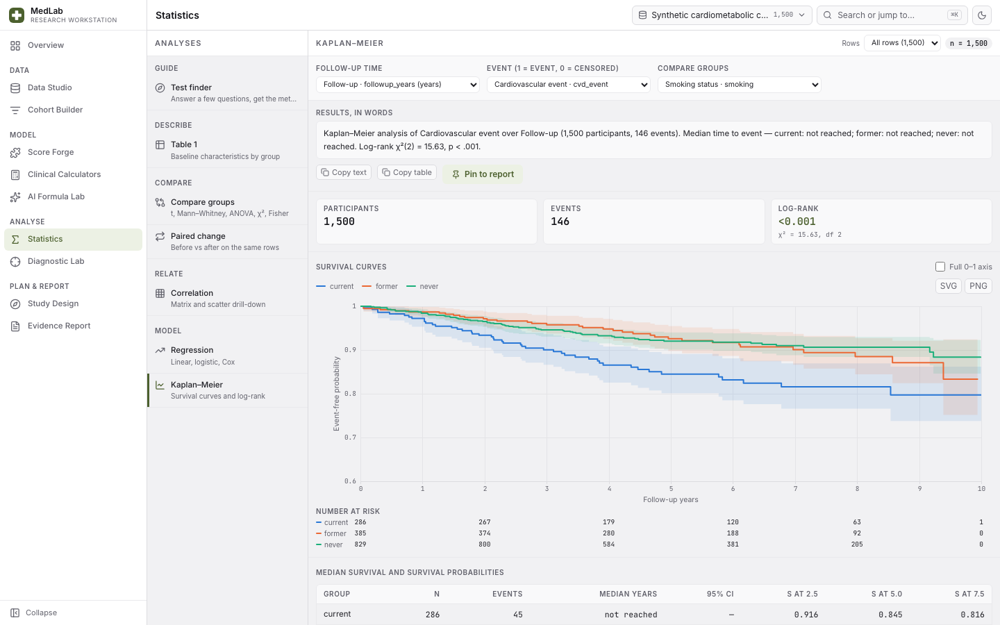
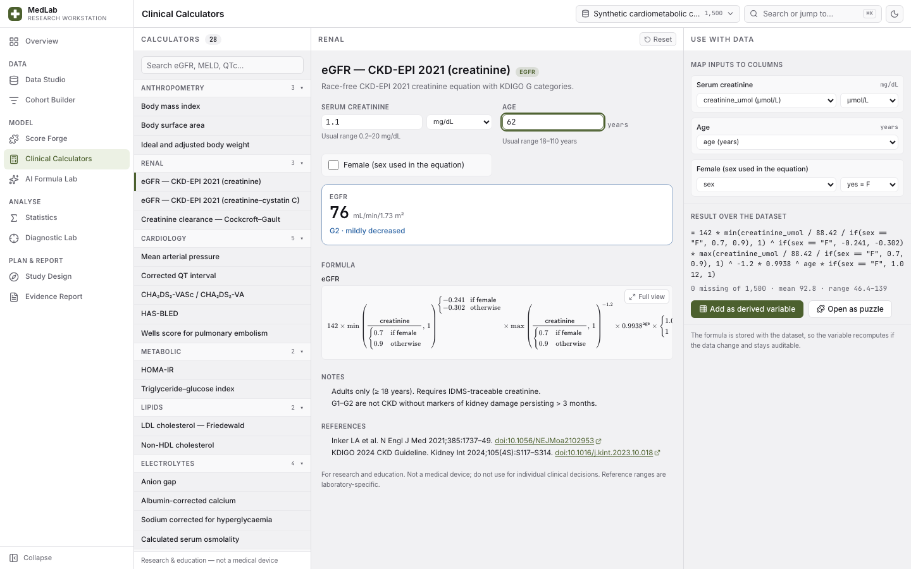

# MedLab — medical research workstation

A local-first workstation for clinical and epidemiological research: import data,
build cohorts and risk scores by **snapping puzzle pieces together**, run the
statistics a paper needs, judge diagnostic accuracy, plan the study, and keep every
result in an evidence report with its provenance. It grew out of the
**LLM-AST Validator**, whose AI formula loop is kept intact as the *AI Formula Lab*.

Everything runs on your machine: a React frontend talks only to a local API
(`127.0.0.1`) that stores datasets and saved work in SQLite.

> For research and education. Results are exploratory unless validated
> independently; the calculators are not a medical device.

| Cohort Builder | Score Forge |
| --- | --- |
|  |  |
| **Statistics** | **Clinical Calculators** |
|  |  |

<sub>All screenshots show the built-in synthetic sample data.</sub>

## Modules

| Module | What it does |
| --- | --- |
| **Overview** | Active dataset, guided first steps, three synthetic sample datasets, and a catalogue of **18 public research datasets** (below). |
| **Data Studio** | CSV/TSV import with a live typed preview, column profiles and distributions, virtualized data grid, analysis roles (outcome, time, event, group, exposure), numeric / categorical / **yes/no** columns (yes/no, y/n and true/false spellings are recognised on import) with conversion that previews exactly what would be lost, a one-click merge for values that differ only in letter case, **derived variables stored as formulas** (always recomputed, never baked), and CSV export. |
| **Cohort Builder** | Inclusion/exclusion criteria as stackable puzzle pieces under a ▶ start block, or added from a quick-criterion bar. A **CONSORT-style participant flow** recomputes on every snap and accounts for every removed row, including rows lost to missing data. Download the remaining rows as CSV. |
| **Score Forge** | Assemble a risk score from blocks (or start from a calculator template). Every change re-evaluates discrimination: ROC curve, **AUC with DeLong CI**, a threshold slider with the live 2×2, and event rate by score decile. |
| **Clinical Calculators** | 28 validated calculators (eGFR CKD-EPI 2021, MELD-Na, MELD 3.0, CHA₂DS₂-VA(Sc), QTc, FIB-4, CURB-65, qSOFA, PHQ-9, …) with unit conversion, range checks, interpretation bands, typeset formulas and primary citations. **Map a calculator onto your dataset's columns** to create a derived variable or open it as puzzle pieces. |
| **Statistics** | A **test finder** that walks you to the right method, then Table 1, group comparisons (t / Mann–Whitney / ANOVA / Kruskal–Wallis / χ² / Fisher with OR, RR, RD), paired change, correlation matrix with drill-down, linear / logistic / Cox regression with forest plots and calibration, and Kaplan–Meier with log-rank and numbers at risk. Each analysis writes an **APA-style results paragraph**. |
| **Diagnostic Lab** | 2×2 accuracy with Wilson and log-method intervals, a ROC explorer on your data with a live threshold, an interactive **Fagan nomogram**, and a **natural-frequency pictograph** that explains what a positive result means. |
| **Study Design** | A PICO question built from synonym pieces that writes the **PubMed and ClinicalTrials.gov searches**, sample size and power with a live power curve, and tickable reporting checklists (CONSORT 2025, STROBE, STARD 2015, TRIPOD+AI, PRISMA 2020, SPIRIT 2025). |
| **Evidence Report** | Every pinned result in order, annotated, with provenance (dataset content hash, cohort, rows, formula, time); export as Markdown or self-contained HTML with charts. |
| **AI Formula Lab** | The original loop: plain-language requirement → multiple validated formula ASTs → Blockly review → evaluation on the imported diabetes cohort → accept/reject. |

## The puzzle idea

One typed expression language (`shared/workbench/expr.ts`) sits under every
formula surface — cohort criteria, derived variables, Score Forge, the calculator
library. Its three value types map onto Blockly connector **shapes**: yes/no
pieces are hexagons, numbers are rounded, text is square, so a piece of the wrong
kind physically refuses to fit. Each formula has three synchronized views — the
blocks, live LaTeX, and an editable text bar (`age >= 18 and sex == "F"`) — and
the server re-validates everything it stores. Missing data is explicit: undefined
arithmetic (÷0, ln 0) becomes *missing*, never `NaN`, and `and`/`or` use
three-valued logic.

## Public research datasets

Real, de-identified data from published studies, one click away on the Overview
(or ⌘K → “Add public dataset”). The repository holds **metadata only** — source
URL, pinned SHA-256, licence, citation and a column contract with labels, units,
analysis roles and readable codings (`shared/workbench/publicDatasets.ts`). When
you add one, the local API downloads it from the official source, refuses it if
the digest or the format no longer matches, and stores it only in your local
database. Cite the source when you publish.

| Dataset | Rows | Design | Good for | Source · licence |
| --- | ---: | --- | --- | --- |
| Heart failure clinical records | 299 | Prospective cohort | Kaplan–Meier, Cox regression, Logistic regression | [UCI](https://archive.ics.uci.edu/dataset/519/heart+failure+clinical+records) · CC-BY-4.0 |
| Cleveland heart disease (angiography) | 303 | Diagnostic accuracy study | ROC, Logistic regression, Table 1 | [UCI](https://archive.ics.uci.edu/dataset/45/heart+disease) · CC-BY-4.0 |
| Breast cancer Wisconsin (diagnostic) | 569 | Diagnostic accuracy study | ROC, Logistic regression, Score Forge | [UCI](https://archive.ics.uci.edu/dataset/17/breast+cancer+wisconsin+diagnostic) · CC-BY-4.0 |
| Early-stage diabetes symptoms (Sylhet) | 520 | Cross-sectional | Score Forge, Logistic regression, Diagnostic 2×2 | [UCI](https://archive.ics.uci.edu/dataset/529/early+stage+diabetes+risk+prediction+dataset) · CC-BY-4.0 |
| Indian liver patient records | 583 | Case–control | ROC, Logistic regression, Compare groups | [UCI](https://archive.ics.uci.edu/dataset/225/ilpd+indian+liver+patient+dataset) · CC-BY-4.0 |
| Breast cancer Coimbra (biomarkers) | 116 | Case–control | ROC, Logistic regression, Compare groups | [UCI](https://archive.ics.uci.edu/dataset/451/breast+cancer+coimbra) · CC-BY-4.0 |
| Mayo Clinic primary biliary cholangitis trial | 418 | Randomised trial + cohort | Kaplan–Meier, Cox regression, Table 1 | [Rdatasets](https://vincentarelbundock.github.io/Rdatasets/doc/survival/pbc.html) · LGPL-2.0-or-later |
| NCCTG advanced lung cancer | 228 | Prospective cohort | Kaplan–Meier, Cox regression, Correlation | [Rdatasets](https://vincentarelbundock.github.io/Rdatasets/doc/survival/cancer.html) · LGPL-2.0-or-later |
| German Breast Cancer Study Group trial | 686 | Randomised trial cohort | Kaplan–Meier, Cox regression, Table 1 | [Rdatasets](https://vincentarelbundock.github.io/Rdatasets/doc/survival/gbsg.html) · LGPL-2.0-or-later |
| Rotterdam breast cancer cohort | 2,982 | Retrospective cohort | Kaplan–Meier, Cox regression, Table 1 | [Rdatasets](https://vincentarelbundock.github.io/Rdatasets/doc/survival/rotterdam.html) · LGPL-2.0-or-later |
| Adjuvant chemotherapy for colon cancer | 929 | Randomised trial | Kaplan–Meier, Cox regression, Compare groups | [Rdatasets](https://vincentarelbundock.github.io/Rdatasets/doc/survival/colon.html) · LGPL-2.0-or-later |
| Veterans' Administration lung cancer trial | 137 | Randomised trial | Kaplan–Meier, Cox regression, Log-rank | [Rdatasets](https://vincentarelbundock.github.io/Rdatasets/doc/survival/veteran.html) · LGPL-2.0-or-later |
| Monoclonal gammopathy (MGUS) natural history | 1,384 | Retrospective cohort | Kaplan–Meier, Cox regression, Compare groups | [Rdatasets](https://vincentarelbundock.github.io/Rdatasets/doc/survival/mgus2.html) · LGPL-2.0-or-later |
| Low infant birth weight (Baystate) | 189 | Cohort | Logistic regression, Compare groups, Table 1 | [Rdatasets](https://vincentarelbundock.github.io/Rdatasets/doc/MASS/birthwt.html) · GPL-2.0-only OR GPL-3.0-only |
| Rectal indomethacin to prevent post-ERCP pancreatitis | 602 | Randomised trial | Compare groups, Logistic regression, Table 1 | [Rdatasets](https://vincentarelbundock.github.io/Rdatasets/doc/medicaldata/indo_rct.html) · MIT |
| Licorice gargle before intubation | 235 | Randomised trial | Compare groups, Paired change, Table 1 | [Rdatasets](https://vincentarelbundock.github.io/Rdatasets/doc/medicaldata/licorice_gargle.html) · MIT |
| Streptomycin for tuberculosis (MRC 1948) | 107 | Randomised trial | Compare groups, Diagnostic 2×2, Table 1 | [Rdatasets](https://vincentarelbundock.github.io/Rdatasets/doc/medicaldata/strep_tb.html) · MIT |
| NHEFS: smoking cessation and weight gain | 1,629 | Prospective cohort | Linear regression, Logistic regression, Table 1 | [Rdatasets](https://vincentarelbundock.github.io/Rdatasets/doc/causaldata/nhefs.html) · MIT |

Check every source against its pin with `npm run verify:public-datasets` (needs
network; prints counts only). Browser tests never download real data — their API
serves a synthetic stand-in that the digest check must refuse.

## Start

```bash
npm ci
make up
```

Open [http://127.0.0.1:5173](http://127.0.0.1:5173) and load a synthetic sample
from the Overview. The AI Formula Lab additionally needs `OPENAI_API_KEY` in `.env`
(copy `.env.example`) and the cohort described in [data/README.md](data/README.md);
every other module works without them.

## Develop and verify

```bash
npm run check        # shared-UI guard, all unit tests, type-check and build
npm run test:e2e     # Playwright: Formula Lab loop, workstation workflow, axe-core WCAG 2.1 AA scans
SCREENSHOTS=1 npx playwright test e2e/screenshots.spec.ts   # regenerate docs/screenshots (synthetic data)
```

The statistics engine (`shared/stats`) is dependency-free TypeScript whose tests
pin values produced by **R 4.5** (`lm`, `glm`, `survival::coxph/survfit/survdiff`,
`t.test`, `wilcox.test`, `chisq.test`, `fisher.test`, `power.t.test`, …).
Calculator tests use the worked examples of the primary sources, including the
official OPTN MELD example. See [docs/workstation.md](docs/workstation.md) for the
architecture.

## Data and privacy

- Datasets, cohorts, scores, study plans and report items live only in the local
  SQLite database (`var/`, ignored by Git). Nothing is deleted: datasets and
  documents are archived and can be restored.
- The browser keeps only UI preferences (theme, collapsed rail, active dataset)
  in `localStorage`.
- The only outbound requests are the public-dataset downloads you start, plus
  the PubMed / ClinicalTrials.gov searches and references you choose to open.
- Built-in samples are **synthetic** — generated with a fixed seed, describing no
  real person.
- Public datasets are downloaded only when you ask, only from the catalogue's
  sources (UCI and Rdatasets), and are verified before anything is stored. Their
  rows never enter Git, fixtures, screenshots or test artifacts.

## Credits

Built on open-source work: [Blockly](https://github.com/google/blockly) (Apache-2.0),
[KaTeX](https://katex.org) (MIT), [Lucide](https://lucide.dev) icons (ISC),
[Papa Parse](https://www.papaparse.com) (MIT), [TanStack Query & Virtual](https://tanstack.com)
(MIT), [Hono](https://hono.dev) (MIT) and [better-sqlite3](https://github.com/WiseLibs/better-sqlite3)
(MIT). Reporting-checklist items are short paraphrases for tracking only; each
checklist links to and cites its official, open-access source.

MIT licensed — see [LICENSE](LICENSE).
