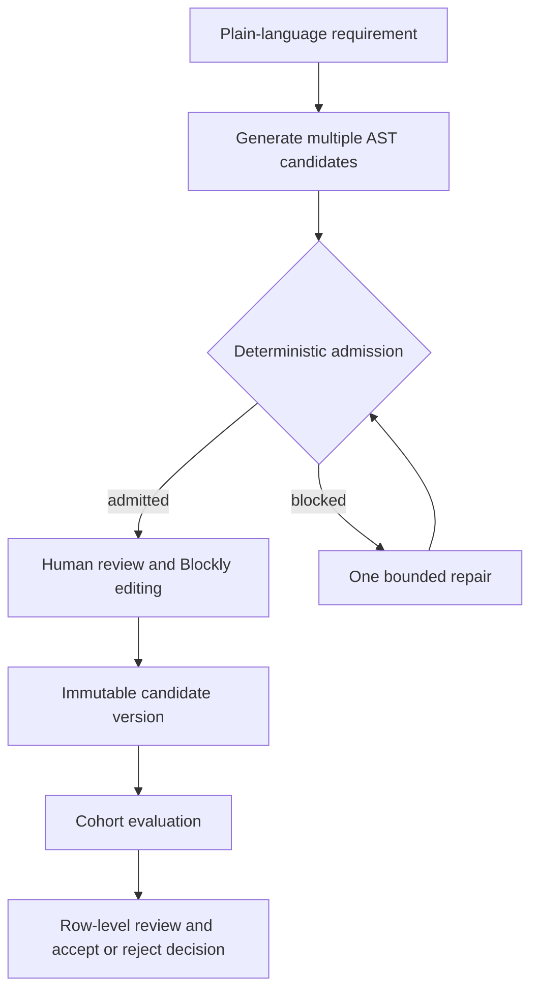
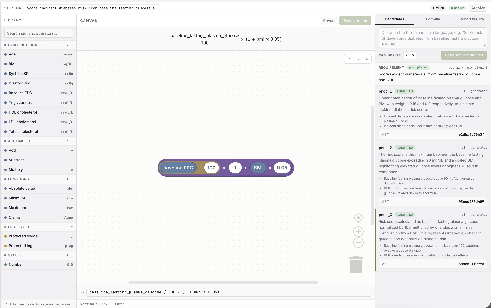
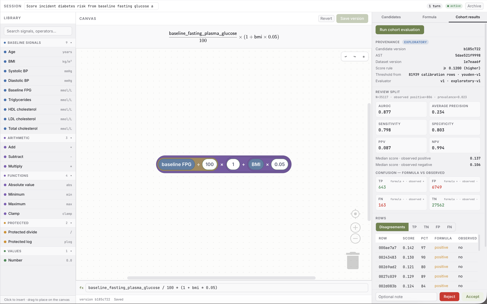

# LLM-AST Validator

LLM-AST Validator turns a plain-language requirement into candidate formula
ASTs, lets you review and edit a selected formula in Blockly, then evaluates
the saved version against a local cohort.

## Pipeline



## Highlights

- **A request becomes alternatives, not a single opaque answer.** Each
  generation turn presents several candidate ASTs for comparison and keeps
  every admitted proposal visible, so the user—not the model—chooses which
  direction to explore.
- **Generation stays inside a reviewable boundary.** Every candidate passes
  deterministic schema, name, type, semantic, runtime, and evidence checks
  before it can enter the editor. A blocked candidate receives at most one
  bounded repair, keeping the loop predictable.
- **The formula is visual and editable, rather than a static response.** The
  Blockly canvas renders the AST as interactive blocks, letting users inspect
  and modify the formula directly, see the corresponding expression, and save
  the edit as a new immutable version.
- **Evidence remains attached to the decision.** Evaluation records the exact
  formula version, dataset version, threshold rule, and evaluator version. The
  cohort view makes disagreement rows inspectable before the user explicitly
  accepts or rejects the result.

## Demo

Generate and review multiple admitted formula candidates:



Evaluate the saved formula against the cohort and inspect its results:



## Start

```bash
npm ci
cp .env.example .env
# Set OPENAI_API_KEY in .env
make up
```

Open [http://127.0.0.1:5173](http://127.0.0.1:5173).
